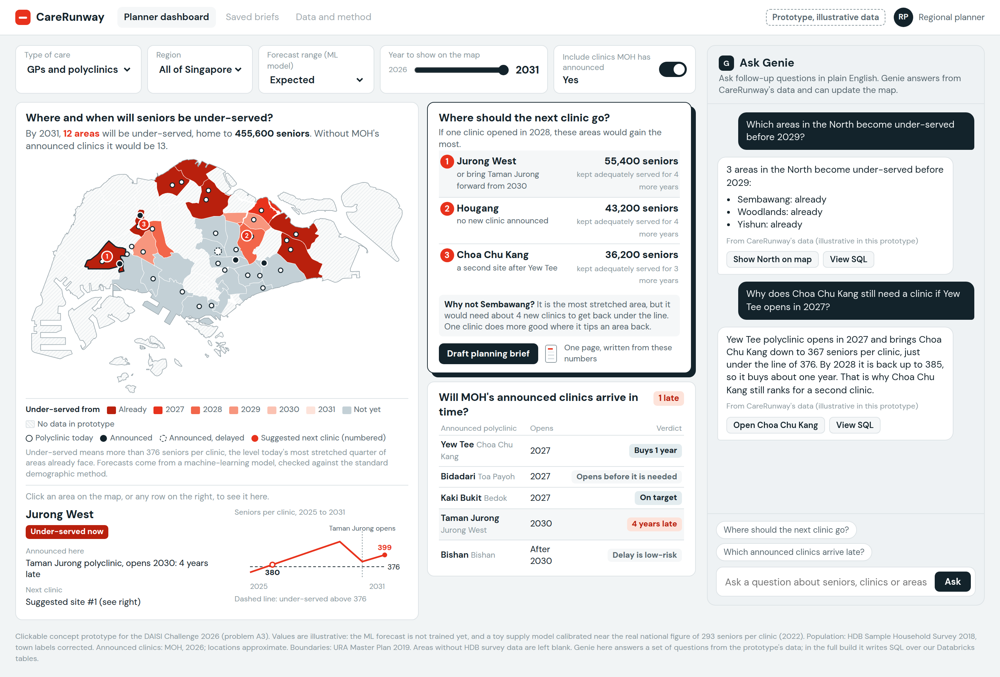
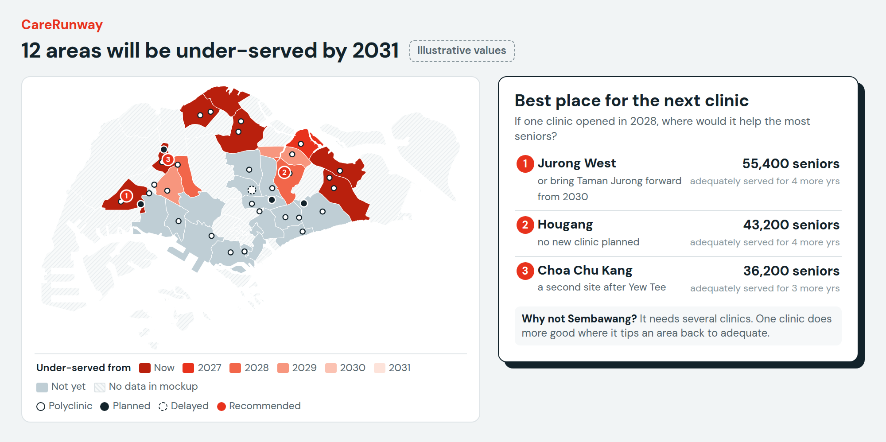
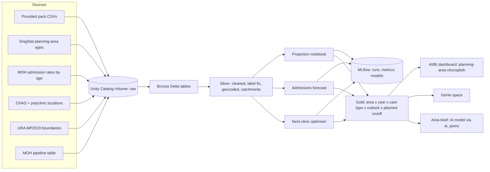

# CareRunway

**Where will seniors run short of clinics, and where should the next clinic go?**

DAISI Challenge Singapore 2026 · Problem A3 HealthPulse (community healthcare demand forecasting)
Status: Round 1 concept (draft 5) · Clickable prototype: https://claude.ai/artifact/KWxnv7oRJRx4aS9JTt8oXy (share it before submitting) · Round 1 due **6 Oct 2026, 11:59 pm SGT** (11:59 am Toronto)



> Every number in the mockup is illustrative. It comes from a toy supply assumption and exists to show how the product works, not what it will find. Section 8 lists what is real.

---

## Contents

1. [Pitch](#1-pitch)
2. [Problem](#2-problem)
3. [Users and the decision we support](#3-users-and-the-decision-we-support)
4. [Product (draft 3)](#4-product-draft-3)
5. [Method](#5-method)
6. [Data](#6-data)
7. [Data-quality findings](#7-data-quality-findings)
8. [Mockup: what is real, what is illustrative](#8-mockup-what-is-real-what-is-illustrative)
9. [Architecture on Databricks](#9-architecture-on-databricks)
10. [Setup](#10-setup)
11. [Round 1 submission plan](#11-round-1-submission-plan)
12. [Team split and timeline](#12-team-split-and-timeline)
13. [Judge Q&A prep](#13-judge-qa-prep)
14. [Open items](#14-open-items)
15. [Changelog](#15-changelog)

---

## 1. Pitch

CareRunway forecasts **seniors per clinic** in every planning area to 2031 and answers the question planners actually decide: **where should the next clinic go?** It does three things:

1. **Forecast:** a machine-learning model, tested against the standard demographic method, predicts seniors in every area to 2031; from that we get the year each area becomes under-served (more seniors per clinic than today's worst-served quarter of areas).
2. **Planned clinics check:** grades every MOH-announced polyclinic: on target, buys N years, ahead of need, or late.
3. **Next-clinic recommender:** an optimiser tests candidate sites and ranks them by how many seniors each keeps adequately served.

Planners then ask Genie follow-up questions and export a one-page planning brief.

What makes it different from a demand dashboard:

- **It recommends an action, not just a heatmap.** Example insight: the most stretched area (Sembawang) is not the best place for *one* clinic, because it needs several; one clinic does more good where it tips an area back to adequate.
- **It grades MOH's own pipeline**, including delays such as Bishan.
- **It shows its own error.** Backtest error and data dates sit on screen (once built).

**Plain language only.** The interface uses "seniors per clinic", "under-served" and "under-served from (year)". Internal terms (strain line, clinic-equivalent, gap year) stay in the method section.

## 2. Problem

- **Seniors are outgrowing clinics.** From 2015 to 2022, the population aged 65+ grew 45% (506,242 to 734,857) while polyclinics plus GP clinics grew 28% (1,951 to 2,504). Seniors per clinic rose from 259 to 293. Sources: provided datasets *Total Population by Broad Age Group and Sex* and *Health Facilities (Primary Care)*. (65+ reached 866,403 by 2025.)
- **Supply comes in lumps and gets delayed.** MOH counted 28 polyclinics at end-Feb 2026 and plans 32 by 2030. New sites: Bidadari, Kaki Bukit and Yew Tee by 2027, Taman Jurong by 2030. Bishan's new polyclinic moved from "by 2030" (2025 plan) to "beyond 2030" (2026 update).
- **Care is shifting to the community.** Over 1.4 million residents, 59% of those eligible, had enrolled in Healthier SG as of May 2026, which moves load onto GPs and polyclinics.
- **Nothing public answers "where, and when".** Existing tools either list raw statistics (SingStat, data.gov.sg), locate today's services (AIC Eldercare Locator, HealthierSG GoWhere), or are one-off academic snapshots. None is forward-looking, area-level, multi-setting and aware of the pipeline.

## 3. Users and the decision we support

| User | Decision | What they need to see |
|---|---|---|
| **Regional health cluster planners** (primary): NHG Health (Central and North), NUHS (West), SingHealth (East) | Where to site the next Healthier SG clinic or community health post, and which areas need outreach first | Their region's gap years, the top strained areas, and an area brief they can take into a planning meeting |
| MOH planning | Is the announced pipeline enough? What comes after 2030? | Planned facilities on vs off, demand outlook bands, the method and its error |
| AIC and eldercare operators | Where to bid for new nursing home or day care places | Nursing home view: load per bed by area |
| Town councils and MPs | Is my constituency underserved? | Area card and brief |
| Seniors and caregivers | Beneficiaries, not users | Shorter travel and waits (the impact metric) |

**Why a planner would use this when MOH has internal data:** cluster community teams, operators and town councils don't see MOH's internal projections, and nobody publishes an independent check of the pipeline.

## 4. Product (draft 4)

### Layout

- **Header:** answer-style headline ("12 areas will be under-served by 2031"), an "Illustrative values" tag in concept stage, and two plain chips: *Today's average: N seniors per clinic* and *Under-served above: N*.
- **Controls row:**

| Control | Type | Options | Why it exists |
|---|---|---|---|
| Care type | Dropdown | Clinics / Nursing homes | Different care types strain in different places |
| Area | Dropdown | All Singapore / North / Central / East / West | Clusters plan for their own region |
| Forecast range (ML model) | Dropdown | Low end / Expected / High end | The model's uncertainty range (10th to 90th percentile), so planners see how sure the answer is |
| Show the picture in | Slider | 2026 to 2031 | The "when" control |
| Planned facilities | Switch | Include / Exclude | Shows how much announced clinics help |

- **Map:** planning areas coloured by the year each becomes under-served (Now, 2027 to 2031, Not by 2031); hatched = non-residential or no data. Markers: existing polyclinics (outline), planned (filled), delayed (dashed), recommended sites (numbered red pins).
- **Best place for the next clinic** (main card): the top 3 sites for one clinic opening in 2028, each with the number of seniors kept adequately served and for how many years, plus a "why not the most stretched area?" explanation and a *Draft planning brief* button.
- **Planned clinics check:** every announced polyclinic with its opening year and a verdict chip.
- **Genie ask bar:** free-form questions (e.g. "Which areas in the North become under-served before 2029?").

### Slide version



Used on Round 1 slide 2 (map + recommender card).

## 5. Method

### 5.1 Core definitions

**Load per clinic** for area *a* in year *t*:

```
load(a,t) = demand within reach of a  /  clinic-equivalents within reach of a
```

- **MVP demand:** residents aged 65+.
- **Sprint demand:** need-weighted residents, i.e. residents in each 5-year age band × MOH's admission rate for that age band, normalised. The UI label then becomes "patient load per clinic".
- **Clinic-equivalents:** a GP clinic counts as 1 and a polyclinic as *w*. Calibrate *w* from national attendance data. It's an assumption, so run sensitivity checks on it.
- **Within reach:**
  - MVP: the area itself plus neighbouring areas at 50% weight.
  - Sprint: enhanced two-step floating catchment (E2SFCA), a standard method that counts supply by travel distance with distance decay, using clinic coordinates.

**Under-served line** (internally "strain line"): the load level that today's (2026) most-stretched quarter of areas already experiences, i.e. the 75th percentile of load across areas in 2026.

*Why not the median?* With a median benchmark, half of all areas would be "in gap" by construction.

**Under-served from (year)** (internally "gap year"): the first year an area's projected load crosses the strain line. "Now" means it's already above. The projection counts existing supply plus announced facilities (when the switch is on) and **nothing else**, so it answers "what happens if nothing else is added?"

**Runway:** gap year minus the current year.

**Nursing home view:** same logic, with residents aged 80+ (or 75+) per nursing home bed within reach. This depends on bed-location data (open item).

### 5.2 Population forecast: machine learning, tested against the standard method

This is the core model: every downstream number (under-served year, suggested sites, planned-clinic verdicts) depends on it.

- **Input:** SingStat residents by planning area, 5-year age band, sex and dwelling type, every year 2000 to 2025 (summed over sex and dwelling into `silver_pa_age`).
- **Standard method (baseline):** Hamilton-Perry cohort-change ratios. Each age band moves into the next band at the rate it did over the previous 5 years. Simple, widely used for small-area forecasts, and easy to explain.
- **ML method:** gradient boosting (scikit-learn `HistGradientBoostingRegressor`) predicts each band's 5-year change ratio (log scale) from: the previous ratio, the area's overall growth, its share of residents aged 65+, the band's share, area size, and region.
- **Training rows:** one per area, age band and start year. With annual data from 2000 to 2025 that's roughly 15,000 rows; it trains in seconds on Free Edition.
- **Backtest:** two folds. Train only on windows that finished by 2015 and predict 2015 to 2020; then by 2020 and predict 2020 to 2025. The error measure is what the product uses: mean absolute percentage error in residents aged 65+ per area.
- **Decision rule:** use the ML forecast only if it beats the baseline on every fold; otherwise ship the baseline and report both. Either outcome is logged and shown.
- **Forecast range:** two extra gradient-boosting models trained on the 10th and 90th percentiles give the low and high ends that drive the "Forecast range" control.
- **Explainability:** feature importance per area, so planners can see why an area's forecast moves.
- **Edge cases:** new towns with little history (e.g. Tengah) are flagged as higher uncertainty and use the baseline plus housing plans.
- **Code:** `notebooks/03_forecast_ml.py` (starter: features, baseline, backtest, quantile models, MLflow logging; smoke-tested on synthetic data).

### 5.2b MLflow

- **Experiment** `area_forecast`: each run logs parameters, the feature list, baseline and ML error for each fold, and whether ML won.
- **Models:** point model plus 10th and 90th percentile models, logged with signatures.
- **Registry:** the point model is registered in Unity Catalog as `workspace.carerunway.area_forecast` only if it wins; the gold tables record which method produced each forecast.
- **Admissions forecast** (Section 5.6) logs to its own experiment.

### 5.3 Supply

- **Existing:** CHAS GP clinic locations and polyclinic locations, geocoded to planning areas and catchments.
- **Planned:** a hand-built table of MOH-announced facilities (site, type, expected year, source URL), including delays such as Bishan. It's version-controlled and cited line by line.

### 5.4 Forecast range and scenarios

- **Forecast range** (low / expected / high) comes from the 10th, 50th and 90th percentile models in 5.2.
- **Healthier SG effect** is a separate, documented scenario (stretch goal), applied on top of the forecast, not mixed into the model.

### 5.5 Validation (drives the "Model check" chip)

1. **Forecast backtest:** baseline vs ML on the two folds in 5.2, reported by area and overall.
2. **National reconciliation:** projected demand summed across areas must track actual public-hospital admissions (provided monthly data, 1987–2026) within a stated tolerance.
3. **Sanity checks:** facility counts vs MOH published totals; population totals vs SingStat.

### 5.6 Admissions forecast (ML, tracked in MLflow)

- **Input:** provided monthly admissions by hospital (Jan 1987 to Jul 2026). Hospitals map to cluster regions.
- **Model:** compare a seasonal baseline against two or three candidates (e.g. SARIMA, gradient boosting with calendar features). Choose by rolling-origin backtest.
- **Use:** a regional pressure panel, plus a cross-check that the demand model's trend matches observed admissions.
- Drop the Jul 2026 figures before training (see Section 7).

### 5.7 Next-clinic recommender (optimiser)

- **Candidates:** v1 = one site per planning area (at its population-weighted centre); v2 = actual land parcels or town-centre sites.
- **Effect of a new clinic:** adds clinic-equivalents to every area within reach from its opening year (default 2028), using the same catchment rules as supply.
- **Objective:** maximise senior-years kept below the under-served line, 2028 to 2031. Greedy selection: pick the best site, update loads, repeat for k clinics, report each site's marginal benefit.
- **Why greedy:** it's standard for maximal-coverage facility location, easy to explain, and fast enough to precompute for every scenario.
- **Output:** ranked sites with seniors kept adequately served and years gained; a note when the most stretched area isn't the top pick (it needs more than one clinic).

### 5.8 Planned clinics check

For each MOH-announced facility, compare the area's load with and without it:

| Verdict | Rule |
|---|---|
| Ahead of need | Area not under-served by 2031 even without it |
| On target | Keeps the area adequately served from opening through 2031 |
| Buys N years | Keeps it adequate for N years, then it slips back |
| N years late | Area already under-served, and still over the line when it opens |
| Delay is low-risk / Delay hurts | For facilities pushed beyond 2030 |

### 5.9 Planned facilities pipeline (how future sites get in)

MOH announcements are unstructured text, so this is a small pipeline of its own.

| Stage | What happens | Databricks piece |
|---|---|---|
| Sources | MOH newsroom (press releases, Committee of Supply speeches), Parliament replies, regional health cluster pages; URA Master Plan land zoned for health and medical care, as a cross-check | Lakeflow Job, weekly |
| Bronze | Raw page text saved with URL and fetch date | Volume + `bronze_moh_pages` |
| Extract | An AI model reads each new page and returns structured rows: facility, type, site, expected year, status (new / delayed / opened), quote, URL | `ai_query()` in SQL |
| Silver | Rows geocoded to planning areas (OneMap). Changes are kept as history, so "Bishan: by 2030" then "Bishan: beyond 2030" becomes a dated delay event | `silver_planned_facilities` (history kept) |
| Review | New or changed rows wait for a person to approve them before they reach the model. Low-confidence extractions are flagged | Review table or small App |
| Gold | Approved facilities feed supply, the planned-clinics check and the recommender | `gold_planned_facilities` |

For Round 1 and the sprint, start with a hand-curated CSV of announced facilities with a source URL per row. Automated extraction and delay alerts are the stretch goal.

### 5.10 AI features

- **Genie space.** Planners ask questions in plain English; Genie writes SQL against curated gold tables. We make it reliable with column descriptions, instructions and saved example questions (Section 10, step 7).
- **Area brief.** An AI model receives the area's row from the gold table (numbers, gap year, planned facilities, sources) and writes a one-page memo.
  - Guardrails: numbers are inserted from the table, never generated.
  - The model writes only the connecting prose.
  - Every brief lists its data sources and dates.
- **ML area forecast** (Section 5.2) and **admissions forecast** (Section 5.6), logged in MLflow. The **optimiser** (Section 5.7) is an optimisation step, not ML; its benefit metrics are logged too.

## 6. Data

### 6.1 Provided pack

| File | What it is | Coverage | How we use it | Issues |
|---|---|---|---|---|
| `AdmissionsToPublicSectorHospitalsMonthly.csv` | Monthly admissions, total + 14 public hospitals | Jan 1987 to Jul 2026 | Admissions forecast, national reconciliation, regional pressure | Jul 2026 identical to May 2026 in every series; newer hospitals have short histories |
| `HDBElderlyandFutureElderlyResidentPopulationbyGeographicalDistribution.csv` | HDB residents 65+ and 55–64 by town | 2003, 2008, 2013, 2018 | Backtest and cross-check only (not the base) | Town labels scrambled in 8 rows (Section 7); 2018 rounded to nearest 100; latest is 2018 |
| `Health Facilities and Beds in Inpatient Facilities*.csv` | Facility and bed counts by type (national) | 2009–2022 | National sanity checks, nursing home bed trend | National only, no locations; ends 2022 |
| `Health Facilities (Primary Care, Dental Clinics and Pharmacies).csv` | Polyclinic and GP clinic counts (national) | 2009–2022 | Calibrating clinic-equivalents | National only; 23 polyclinics in 2022 vs MOH's 28 in 2026 |
| `TotalPopulationByBroadAgeGroupAndSexAtEndJuneAnnual.csv` | Population by 0–14 / 15–64 / 65+ and sex | 1957–2025 | Headline stats, national control totals | Total population (includes non-residents) |
| `HealthcareSchemesandSubsidies.csv` | List of scheme names and types | Current | Area brief context only | Names only, no figures |

### 6.2 External public datasets to add (allowed if cited)

| Dataset | Source | Why |
|---|---|---|
| Residents by planning area/subzone, age group, sex and dwelling type, 2000–2025 | SingStat | Projection base (replaces HDB 2018 as the base) |
| Hospital admission rates by age (5-year bands) and sex | MOH | Need weights |
| CHAS clinics (with coordinates) | data.gov.sg (MOH), last updated Jun 2024 | GP supply |
| Polyclinic locations | MOH / HealthHub / OneMap (to confirm) | Polyclinic supply |
| Master Plan 2019 Planning Area Boundary (No Sea) | data.gov.sg (URA) | Map geometry and catchments |
| Complete life tables | SingStat | Survival rates for projection |
| Nursing homes with bed counts and locations | AIC / MOH (**availability to confirm**) | Nursing home view |
| HDB resident population by town; age of HDB residents by town | data.gov.sg (HDB) | Fixing and validating the HDB town labels |
| MOH facility pipeline announcements | MOH newsroom (Committee of Supply 2025, 2026) | Planned facilities table |

## 7. Data-quality findings

### 7.1 HDB elderly dataset: town labels scrambled in 8 of 26 rows

- **Symptom:** "Hougang" appears twice every year and Woodlands is missing.
- **Method:** HDB publishes two sibling datasets from the same survey: total HDB residents by town, and each town's age mix. For 2013, expected count = town total × age share, for both the 65+ and 55–64 groups. We compared every row against every town.
- **Result:** rows 1–7 match their labels within about 1%. Rows 8–15 match *other* towns within about 1%. Full table: `mockup/hdb_town_label_fix.csv`.

| Row | Label in source | Actually | 2013 count 65+ (source vs expected) |
|---|---|---|---|
| 8 | Choa Chu Kang | Woodlands | 18,468 vs 18,386 |
| 9 | Hougang (2nd) | Choa Chu Kang | 8,116 vs 8,056 |
| 10 | Bukit Panjang | Bukit Batok | 10,232 vs 10,171 |
| 11 | Pasir Ris | Bukit Panjang | 11,008 vs 11,135 |
| 12 | Bukit Batok | Jurong East | 9,023 vs 9,045 |
| 13 | Jurong East | Serangoon | 7,305 vs 7,300 |
| 14 | Serangoon | Bishan (by elimination) | 8,936 (Bishan's age mix not checked yet) |
| 15 | Bishan | Pasir Ris | 7,502 vs 7,475 |

- **Other years:** we assume the same row order applies to 2003, 2008 and 2018. The corrected 2018 figures are more plausible than the original labels (e.g. Pasir Ris goes from 6.9% to 9.4% seniors, instead of jumping to 15.4%).
- **Rows 16–26:** not yet verified. The first page of the age-mix data covers only 14 towns; download the full file to finish.
- **Impact:** our earlier claim that "Bishan is one of the fastest-ageing HDB towns" was based on a mislabelled row (it was actually Pasir Ris) and is **withdrawn**. Bishan's polyclinic delay is from MOH and still stands.
- **Report upstream:** the dataset contact is feedback@data.gov.sg.

### 7.2 Other issues

- **Admissions:** Jul 2026 equals May 2026 in all 15 series, likely a placeholder. Exclude it until the source updates.
- **Staleness:** HDB survey data ends 2018; CHAS locations last updated Jun 2024; facility counts end 2022. Date-stamp every source on the dashboard.

## 8. Mockup: what is real, what is illustrative

| Element | Status |
|---|---|
| Planning-area boundaries (URA MP2019, no sea) | Real |
| Planned polyclinic sites and the Bishan delay | Real (MOH); marker positions approximate |
| Existing polyclinic markers | Approximate positions for 28 sites; replace with official coordinates |
| Town-level senior counts feeding the toy model | Real HDB 2018 data, labels corrected |
| "Today's average 330 seniors per clinic" | Illustrative, calibrated near the real national figure (293 in 2022) |
| Under-served line (376), area years, headline count | **Illustrative** (toy supply proportional to seniors^0.85) |
| Recommended sites, seniors kept served, planned-clinic verdicts | **Illustrative**; they show how the recommender and check work |

**Regenerate the mockup** (from `mockup/`):

```bash
pip install pandas numpy shapely playwright --break-system-packages
npm install @fontsource/dm-sans
# put the provided CSVs in ./data and the URA boundary GeoJSON at ./pa_hi.geojson
python model_v4.py        # prints toy loads, recommended sites and verdicts
python build_v4.py        # writes mockup_v4_full.html and mockup_v4_slide.html
python shot_v4.py         # renders both to PNG (edit the chromium path inside if needed)
```

## 9. Architecture on Databricks



- **Storage:** Delta tables in Unity Catalog, schema `workspace.carerunway`.
- **Pipelines:** notebooks run as a Lakeflow job (or a declarative pipeline, if time allows).
- **Scenarios are precomputed:** every combination of care type × outlook × planned on/off is written to gold, so dashboard filters just select rows. It's fast, safe for a live demo, and light on Free Edition quotas.
- **Map:** AI/BI dashboards support custom geographies in choropleth maps (since May 2026) via a geometry column. **Check early that this works on Free Edition.** Fallback: a Databricks App with a GeoJSON choropleth.

## 10. Setup

### 10.0 Round 1 quick start: real data in Databricks in about 30 minutes

This gives slide 3 a real screenshot. It uses two files from the provided pack.

1. Sign up for Databricks Free Edition and open **SQL Editor**.
2. Run:
   ```sql
   CREATE SCHEMA IF NOT EXISTS workspace.carerunway;
   CREATE VOLUME IF NOT EXISTS workspace.carerunway.raw;
   ```
3. **Catalog → workspace → carerunway → raw → Upload to this volume.** Upload `TotalPopulationByBroadAgeGroupAndSexAtEndJuneAnnual.csv` and `Health Facilities (Primary Care, Dental Clinics and Pharmacies).csv` without renaming them.
4. Run:
   ```sql
   CREATE OR REPLACE TABLE workspace.carerunway.seniors_by_year AS
   SELECT CAST(yr AS INT) AS year, MAX(CAST(v AS BIGINT)) AS seniors
   FROM (
     SELECT * FROM read_files('/Volumes/workspace/carerunway/raw/TotalPopulationByBroadAgeGroupAndSexAtEndJuneAnnual.csv',
                              format => 'csv', header => true)
     WHERE trim(DataSeries) = '65 Years & Over'
   )
   UNPIVOT (v FOR yr IN (`2009`,`2010`,`2011`,`2012`,`2013`,`2014`,`2015`,`2016`,`2017`,`2018`,`2019`,`2020`,`2021`,`2022`))
   GROUP BY yr;   -- MAX keeps the total row (the other two rows are male and female)

   CREATE OR REPLACE TABLE workspace.carerunway.clinics_by_year AS
   SELECT CAST(year AS INT) AS year, SUM(CAST(no_of_facilities AS INT)) AS clinics
   FROM read_files('/Volumes/workspace/carerunway/raw/Health Facilities (Primary Care, Dental Clinics and Pharmacies).csv',
                   format => 'csv', header => true)
   WHERE facility_type_b IN ('Polyclinics', 'General Practioner Clinics')   -- spelling as in the source
   GROUP BY year;

   SELECT s.year, s.seniors, c.clinics, ROUND(s.seniors / c.clinics) AS seniors_per_clinic
   FROM workspace.carerunway.seniors_by_year s
   JOIN workspace.carerunway.clinics_by_year c USING (year)
   ORDER BY year;
   ```
5. **Check:** 2015 should show 259 and 2022 should show 293 (the numbers on slide 1).
6. In the results pane, add a **line chart** of `seniors_per_clinic` by `year`.
7. Screenshot the editor with the Catalog panel open (so `workspace.carerunway` is visible), the query and the chart. Paste it into the frame on slide 3.

### 10.1 Team workspace (set up once)

Free Edition allows **one workspace per account**, so create one shared team workspace and keep everything in Git.

1. **Owner:** one teammate who will stay active signs up for Free Edition and becomes workspace admin. Optionally verify with LinkedIn to raise some limits.
2. **Add teammates:** *Settings → Identity and access → Users → Add user*, and make them admins. Users can't be removed later, so add only the team. If adding users isn't available, each person uses their own workspace and the repo keeps you in sync.
3. **Repo:** create a GitHub repo from this folder. In Databricks: *Settings → Linked accounts → GitHub*, then *Workspace → Create → Git folder* with the repo URL. Everyone works in their own Git folder and commits there; notebooks live in `notebooks/`.
4. **Storage:** run `notebooks/00_quickstart_seniors_per_clinic.sql` once (it creates `workspace.carerunway` and the `raw` volume), then upload all data files to the volume and log them in `data/SOURCES.md`.
5. **Run in order:** `00` (quick start + screenshot), `01_ingest_bronze` (all CSVs to bronze tables), `02_silver_hdb_label_fix` (corrected HDB towns; asserts 26 towns per year).
6. **Conventions:** one schema `workspace.carerunway`; table prefixes `bronze_`, `silver_`, `gold_`; every gold table and column gets a comment (Genie reads them).
7. **Quota:** Free Edition is serverless only, and going over the fair-use quota shuts compute down for the rest of the day. Don't leave jobs looping, precompute scenarios once, and avoid heavy runs on demo days.

### 10.2 Repo and public prototype (GitHub)

One repo holds everything; GitHub Pages serves the prototype from `docs/index.html`.

1. On github.com, click **New repository**, name it `carerunway`, and choose:
   - **Private** if your account has GitHub Pro (free via the GitHub Student Developer Pack). The code stays private and the prototype page is still public.
   - **Public** otherwise. Free accounts can only publish Pages from public repos. Never commit data files or credentials; `.gitignore` blocks CSVs and zips.
2. Leave "Add a README" unticked and click **Create repository**.
3. Click **uploading an existing file** and drag in everything inside this folder, including `.gitignore` (on a Mac, press Cmd + Shift + . in Finder to show hidden files). Click **Commit changes**.
4. **Settings → Pages:** Source *Deploy from a branch*, Branch *main*, folder **/docs**, then **Save**. After 1 to 2 minutes the address appears: `https://<your-username>.github.io/carerunway/`.
5. **Settings → Collaborators → Add people** to invite teammates by GitHub username.
6. Update the prototype link on slide 2 to the github.io address.

The page shows a large "concept prototype" disclaimer. Adding `#clean` to the address hides it, only for clean screenshots.

### 10.3 Full build

One teammate hosts the Databricks Free Edition workspace. Everyone works from this repo, connected as a Databricks Git folder. Check whether Free Edition lets you add teammates to the workspace.

1. **Create the workspace:** sign up for Databricks Free Edition, then in *Workspace → Create → Git folder*, connect this repo.
2. **Create the schema and volume** (SQL editor):
   ```sql
   CREATE SCHEMA IF NOT EXISTS workspace.carerunway;
   CREATE VOLUME IF NOT EXISTS workspace.carerunway.raw;
   ```
3. **Upload data:** *Catalog → workspace → carerunway → raw → Upload*. Add all provided CSVs plus the external datasets in Section 6.2. Keep original file names and record the download date in `data/SOURCES.md`.
4. **Run the notebooks in order** (`notebooks/`, to be written; names and order are the plan):
   ```
   00_ingest_bronze        read every file in the volume into bronze tables
   01_clean_silver         types, tidy formats, HDB label fix, drop Jul-2026 admissions
   02_geo_silver           boundaries to a geometry column, geocode clinics, build catchments
   03_forecast_ml          standard method vs ML area forecast; backtest; quantile range; MLflow (starter included)
   04_supply_and_load      clinic-equivalents, load, strain line, gap year; all scenarios
   05_admissions_forecast  model comparison with rolling backtest; log to MLflow
   06_gold_publish         write gold tables with column comments
   07_area_brief           ai_query prompt template + guardrails; write briefs table
   ```
5. **Check the gold tables:**
   ```sql
   SELECT care_type, outlook, planned_included, COUNT(*) FROM workspace.carerunway.gold_area_year GROUP BY ALL;
   ```
6. **Build the dashboard:** *New → Dashboard*. Add `gold_area_year` and `gold_area_geo` as datasets. Add a choropleth on the geometry column, dropdown filters for care type, area and outlook, a year slider, and a planned-facilities toggle.
7. **Create the Genie space:** *New → Genie space*. Add the gold tables, then:
   - **Instructions:** "Gap year = first year load crosses the strain line; 'Now' means already above. Strain line = 2026 75th-percentile load. Always state the scenario (care type, outlook, planned facilities) in answers."
   - **Example questions** (save each with correct SQL):
     - Which areas in the North cross the strain line before 2029?
     - How many years does the Yew Tee polyclinic buy Choa Chu Kang?
     - Where is nursing home load growing fastest?
     - What changes if Healthier SG demand is on the Higher outlook?
8. **Record the demo:** 3 minutes, following one area through spot → understand → test → brief.

## 11. Round 1 submission

The deck is built on the official template: `CareRunway_Round1.pptx` (edit) and `CareRunway_Round1.pdf` (submit). **Fill in the team name on slide 1 before exporting.**

| Slide | Claim headline | Main visual | Template prompts answered |
|---|---|---|---|
| 1. Problem | "Seniors are growing faster than the clinics that serve them" | 293 seniors per clinic (2022, up from 259 in 2015); seniors +45% vs clinics +28%; Bishan slip strip | Team, problem statement, one-sentence problem, who is affected (open-data numbers), why now |
| 2. Solution & data | "CareRunway shows where seniors will run short of clinics, and where the next clinic does the most good" | Draft 4 slide crop | Solution, users and decision, 3 datasets + the label fix, why not a generic dashboard |
| 3. Architecture & impact | "Our data is already in Databricks. Here is how it becomes a recommendation." | 5-step pipeline (Lakeflow, Delta, Unity Catalog, MLflow, AI/BI, Genie, App) | Demo output, measurable impact, sprint plan |

## 12. Team split and timeline

| Person | Owns |
|---|---|
| A | Data and demand: SingStat ingest, projection, backtest, admissions forecast |
| A/B | Next-clinic optimiser (shared once loads exist) |
| B | Supply and access: clinic data, geocoding, catchments, pipeline table, nursing home data check |
| C | Product and pitch: dashboard, Genie space, area brief, slides, demo video |

| Dates (SGT) | Milestone |
|---|---|
| 28 Sep – 1 Oct | Confirm external datasets exist; finish label verification (rows 16–26); lock definitions |
| 2 – 4 Oct | Slides v1 with the slide crop and architecture diagram |
| 5 Oct | Review against the rubric; cut anything unclear |
| 6 Oct | Submit PDF by 11:59 pm SGT |
| 9 Oct | Shortlist announced |
| 12 – 26 Oct | Build sprint with mentor |
| 27 Oct | Demo Day (4–7 pm SGT = 4–7 am Toronto) |

## 13. Judge Q&A prep

- **"MOH already does this."** MOH plans nationally with internal data. CareRunway serves the people who act locally without that data, and it independently checks the pipeline.
- **"Why isn't the most stretched area your top pick?"** One clinic can't bring Sembawang back to adequate; it needs several. The optimiser puts one clinic where it does the most good, and flags areas that need a package of clinics.
- **"How do you know a clinic's capacity?"** We don't claim to. The strain line is relative: it compares each area with the level today's most-stretched quarter already live with.
- **"People cross boundaries."** That's why supply is counted within reach (neighbouring areas, then travel-distance catchments), not inside planning-area borders.
- **"What if the ML model doesn't beat the standard method?"** Then we ship the standard method and say so. The rule is set before we see results, both errors are on screen, and the product works either way.
- **"Why trust the projection?"** Backtest error is shown on screen, and the area totals reconcile with actual national admissions.
- **"Healthier SG effect?"** It's a documented band, not a point estimate.
- **"Your data had errors."** We found and fixed a label error in a government dataset and showed the evidence (Section 7).

## 14. Open items

- [ ] Verify HDB label rows 16–26 using the full age-mix file.
- [ ] Confirm polyclinic coordinates (28 sites) and whether Serangoon and Tengah are open.
- [ ] Find nursing home bed locations. If there are none, launch with clinics only and put nursing homes on the roadmap.
- [ ] Calibrate polyclinic weight *w*; pick a sensitivity range.
- [ ] Test custom-geography choropleths and `ai_query` on Free Edition.
- [ ] Confirm whether the finale requires in-person attendance (Zixi is in Toronto until December).
- [ ] Replace illustrative values with real outputs after the sprint.

## 15. Changelog

- **Draft 1:** coarse map; "supply pipeline" dropdown; gap year from ageing-in ratio; Bishan as the hook.
- **Draft 2:** official URA boundaries; question buttons plus Genie; answer-style headline.
- **Draft 9 (ML at the core):**
  - The area forecast is now a machine-learning model (gradient boosting) tested against the standard Hamilton-Perry method on two backtest folds, with a rule to use ML only where it wins. Logged and registered in MLflow.
  - "How fast demand grows" replaced by "Forecast range (ML model)": low end / expected / high end from quantile models.
  - Slides 2 and 3 updated: solution sentence, "different from a generic dashboard", Models box, validation line, impact measure and sprint plan. The optimiser is no longer listed as ML.
  - Starter notebook `notebooks/03_forecast_ml.py` added.
- **Draft 8:** large disclaimer banner on the prototype (what is illustrative and what doesn't work); standalone `docs/index.html` served by GitHub Pages; slide 2 notes the prototype is concept only.
- **Draft 7:**
  - Left panel restructured so every piece links: the map card opens with a one-sentence summary (replacing three number boxes); clicking an area, a suggested site or an announced clinic selects it everywhere (outline on the map, highlighted row, detail strip).
  - Area detail redesigned: status chip, what is announced there, whether it is a suggested site, and a labelled chart with the under-served line and the opening year of any announced clinic.
  - Section titles are now the planner's questions: "Where and when will seniors be under-served?", "Where should the next clinic go?", "Will MOH's announced clinics arrive in time?"
- **Draft 6:**
  - Mockup rebuilt as a real dashboard: app bar, filter bar, three headline numbers, map, two built-in cards, and a separate Genie chat panel showing a two-question conversation with "Show on map" and "View SQL".
  - Plain labels: "Type of care", "Region", "How fast demand grows", "Year to show on the map", "Include clinics MOH has announced".
  - Grey coastline outline on the map. Slide-style headline and top-right chips removed (the definition now sits under the map legend).
  - "Why not Sembawang?" is now generated: the most stretched area is compared with the top picks, and the number of clinics it would need is calculated.
  - Turning off announced clinics shows a banner with the difference, recalculates the suggested sites and pauses the arrival check.
- **Draft 5:**
  - Clickable prototype published (switch, year slider, area filter, outlook, click-for-details, three computed Genie answers, planning brief preview). The static mockups are screenshots of it, so slide and link always match.
  - Credibility fixes: blank areas labelled "No data in mockup" (not "Non-residential"); "2026 estimate" on the 330 figure; unrounded numbers; "Opens before it is needed".
  - Deck copy rewritten in the team's voice: sentence-case prompts, regular weight with one bold phrase per answer, a "we found" line, team line, and a frame for a real Databricks screenshot.
- **Draft 4 (pivot):**
  - Product reframed around the planner's decision: *where should the next clinic go?* Added the next-clinic recommender and the planned clinics check.
  - Plain language in the UI (seniors per clinic, under-served); internal jargon moved to the method.
  - Illustrative numbers recalibrated near the real national figure (293 seniors per clinic in 2022); removed the made-up backtest percentage.
  - Real slide-1 stats from the provided pack (seniors +45% vs clinics +28%, 2015 to 2022).
  - Round 1 deck built on the official template.
- **Draft 3:**
  - Strain-line definition of gap year (relative, computable).
  - Four controls plus a planned-facilities switch; Genie as the only free-form entry point.
  - Existing polyclinics shown; no-data hatch; trust chips; real units in the area card.
  - HDB town labels corrected and the Bishan ageing claim withdrawn; the featured area is now Choa Chu Kang.
  - Slide crop added.
